# Arcana Desktop Rust - Cross-Platform Local-First Desktop App

<div align="center">

A **Local-First, Plugin-Everything** desktop application in Rust + egui — a port of
[arcana-windows](https://github.com/jrjohn/arcana-windows) with Clean Architecture, MVVM-UDF,
a plugin system (built-in + sandboxed WASM), and CRDT offline sync. Runs on Windows, macOS and Linux.

[](#architecture-evaluation)
[](https://www.rust-lang.org/)
[](https://github.com/emilk/egui)
[](https://wasmtime.dev/)
[](#ci)
[](#testing)
[](#testing)
[](LICENSE)

</div>

<!-- agent-managed badges START -->
<p align="center">
  <a href="https://arcana.boo/sonarqube/dashboard?id=desktop-rust-app"></a>
  <a href="https://arcana.boo/jenkins/job/desktop-rust-app-pipeline-mb/job/main/"></a>
</p>
<!-- agent-managed badges END -->
<!-- arch-rank START -->
<p align="center">
  
  
  
</p>
<!-- arch-rank END -->

> **About the arch-qube score.** CI scans with the backend `rust` profile (threshold 90): **100/100,
> 14 rules evaluated, 7 not evaluated**. That profile has no view/view-model layer, so the UI rules
> pass vacuously — `arcana-ui` is never classified. The stricter `rust-desktop` profile
> ([arcana-arch-qube#12](https://github.com/jrjohn/arcana-arch-qube/pull/12), not merged yet)
> classifies every file and scores **97.8 with 10 real layer-direction findings** (view model ↔ view
> types, view → infra / plugin host, dao → repository helpers) plus 6 `Impl` imports in
> `infra/plugin_runtime.rs`, so its gate fails today. The badge shows what CI measures; the
> stricter number is the honest one for the UI layers.

---

## Screenshots

| Home | Order List |
|:-:|:-:|
| 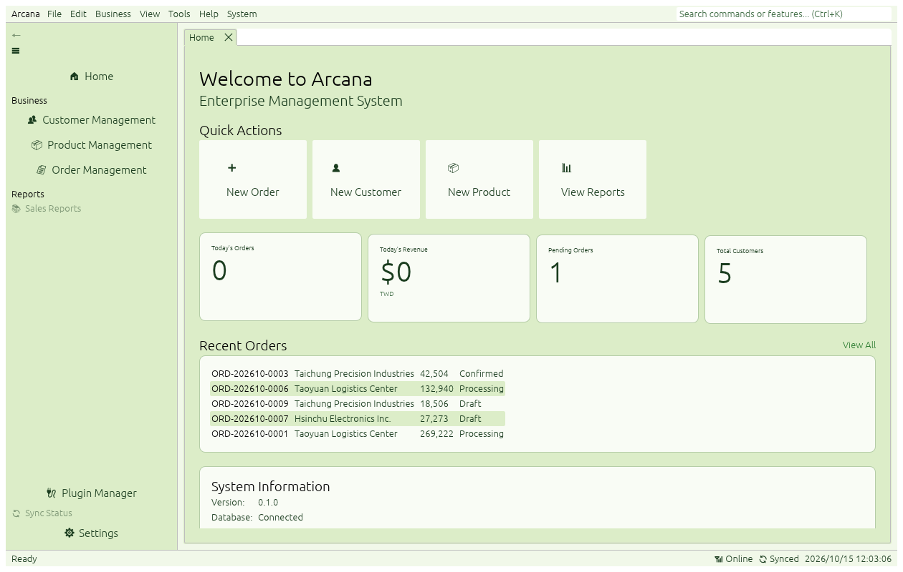 | 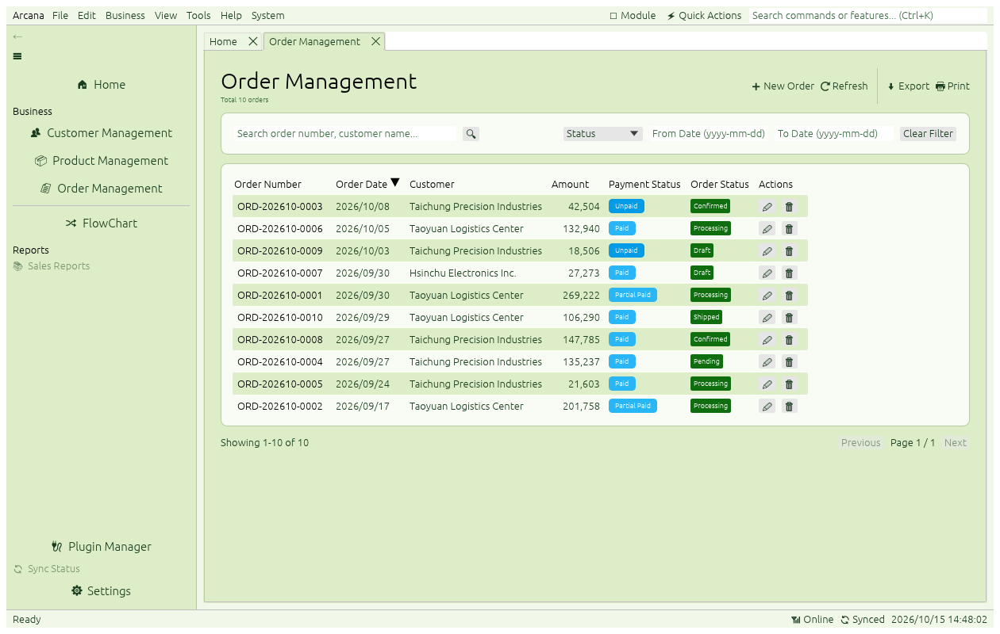 |

| Order Detail | New Order |
|:-:|:-:|
| 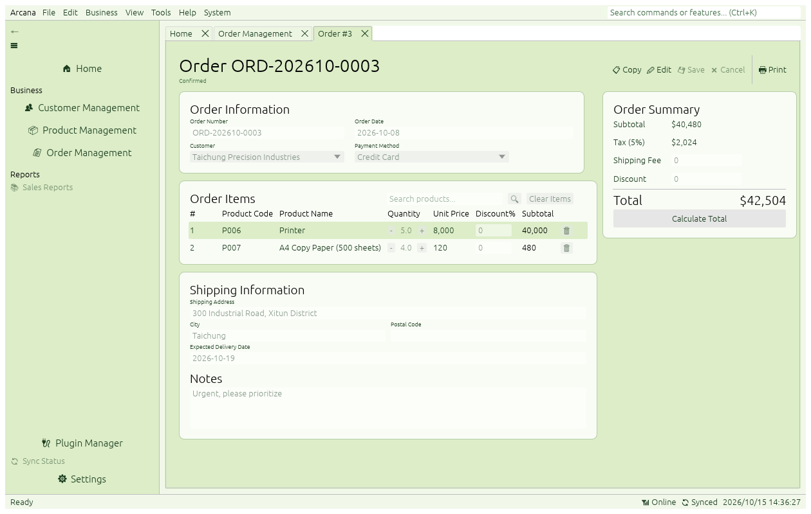 | 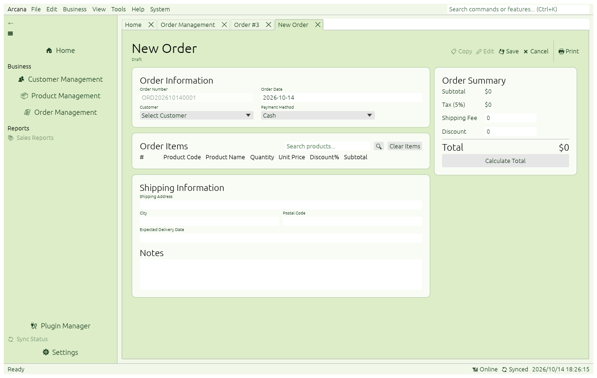 |

| Plugin Manager | Flow Chart Plugin |
|:-:|:-:|
| 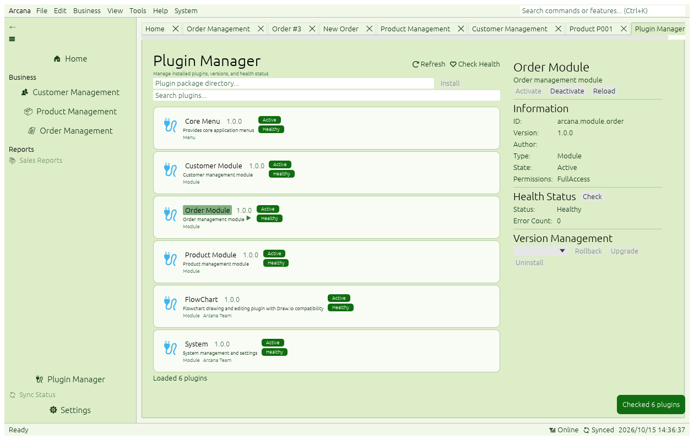 | 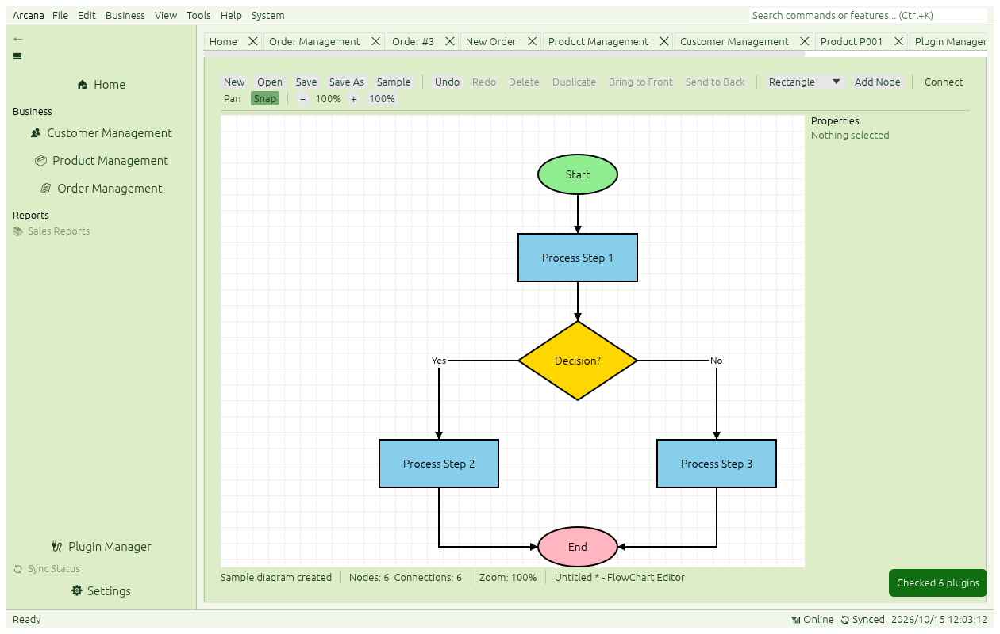 |

| Settings | Settings — Dark, 繁體中文 (zh-TW) |
|:-:|:-:|
| 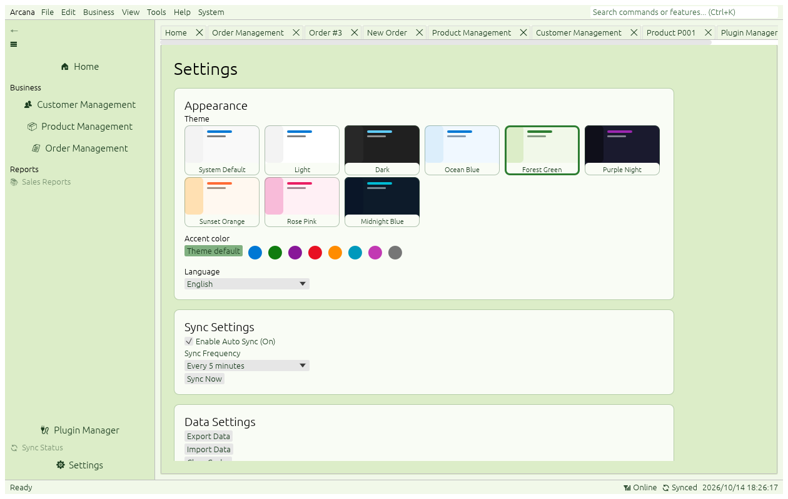 | 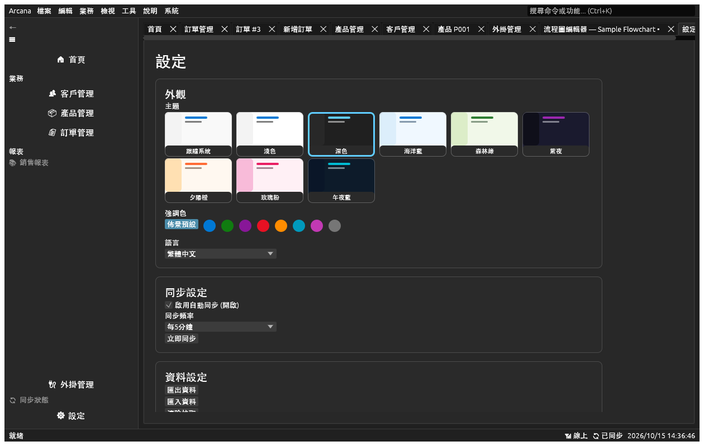 |

| Home — Dark, 繁體中文 (zh-TW) | Product List |
|:-:|:-:|
| 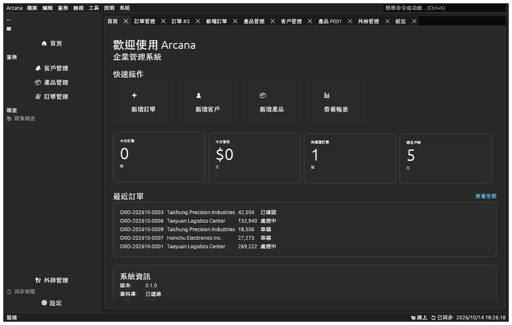 | 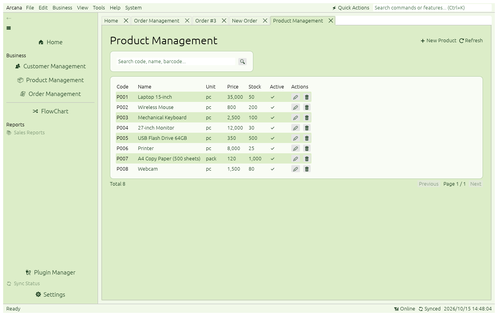 |

Screenshots are rendered headlessly from the real UI code (egui_kittest):
`cargo run -p arcana-app --features screenshots --bin screenshots -- docs/screen-rust`.

---

## Table of Contents

<details>
<summary>Click to expand</summary>

- [Architecture](#architecture)
- [Layer Architecture](#layer-architecture)
- [Plugin System](#plugin-system)
- [MVVM UDF Flow](#mvvm-udf-flow)
- [CRDT Sync System](#crdt-sync-system)
- [Key Features](#key-features)
- [Project Structure](#project-structure)
- [Quick Start](#quick-start)
- [Install (release artifacts)](#install-release-artifacts)
- [Testing](#testing)
- [Code Quality](#code-quality)
- [CI](#ci)
- [Architecture Evaluation](#architecture-evaluation)

</details>

---

## Architecture

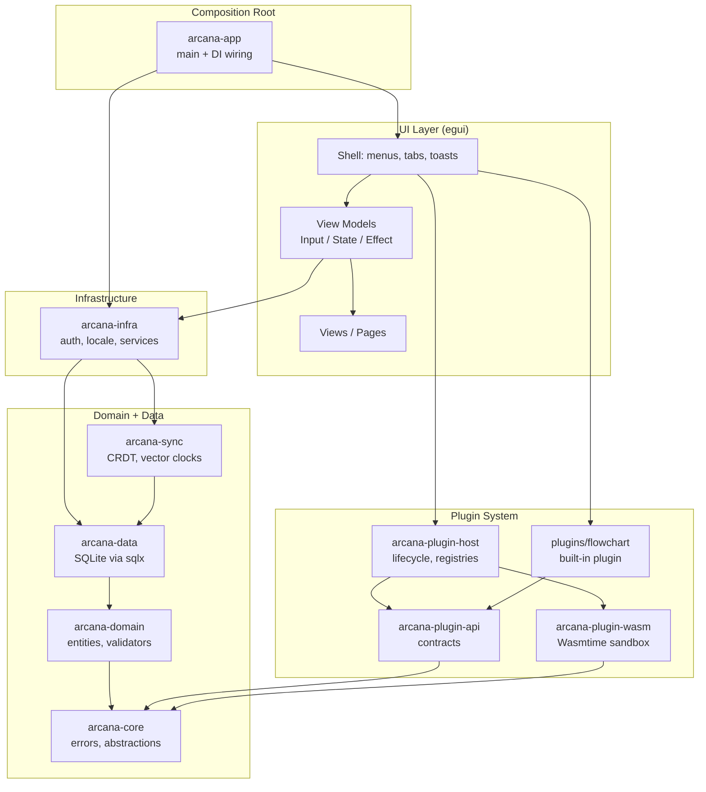

## Layer Architecture

The allow-list in [`xtask/src/main.rs`](xtask/src/main.rs) **is** the architecture: `cargo xtask layers`
fails when a crate depends on a workspace crate it is not allowed to see, when a new crate is not
in the table, or when anything below the UI layer pulls in `egui`/`eframe`.

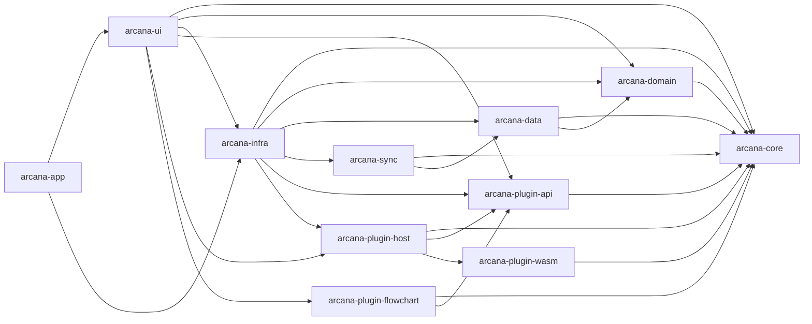

| Crate | Rust LOC (src + tests) | May depend on |
|---|---:|---|
| `arcana-core` | 1,246 | — |
| `arcana-domain` | 2,168 | core |
| `arcana-data` | 3,738 | core, domain |
| `arcana-sync` | 3,871 | core, data |
| `arcana-plugin-api` | 3,467 | core |
| `arcana-plugin-wasm` | 892 | core |
| `arcana-plugin-host` | 11,212 | core, plugin-api, plugin-wasm |
| `arcana-infra` | 8,671 | core, domain, data, sync, plugin-api, plugin-host |
| `arcana-ui` | 11,070 | core, domain, infra, plugin-api, plugin-host, plugin-flowchart |
| `arcana-app` | 453 | ui, infra |
| `arcana-plugin-flowchart` (`plugins/flowchart`) | 4,988 | core, plugin-api |
| `xtask` | 122 | — |
| **Total (12 workspace packages)** | **51,898** | |

Plus `plugins-wasm/example` (73 lines), the sample third-party WASM component, built outside the
workspace by `scripts/build-wasm-example.sh`.

## Plugin System

Two kinds of plugins share one contract (`arcana-plugin-api`) and one host (`arcana-plugin-host`):
**built-in** Rust plugins (FlowChart) linked into the app, and **third-party** WebAssembly
components loaded at runtime into a Wasmtime sandbox, where every host import is gated by the
permissions declared in the plugin manifest.

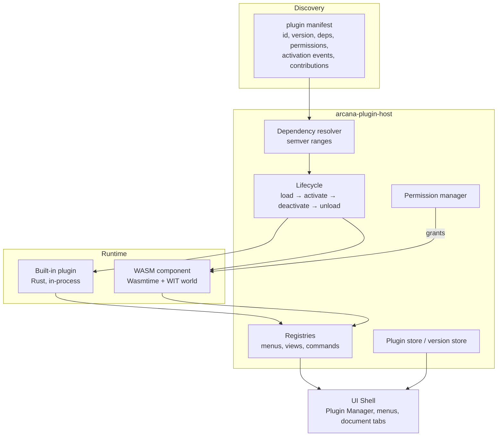

## MVVM UDF Flow

A view model never performs I/O: `on(Input)` mutates its state and returns **effects**
([`crates/arcana-ui/src/effect.rs`](crates/arcana-ui/src/effect.rs)). The shell interprets them —
`Run` goes to the async executor, `Navigate` to the nav graph, `Notify` to the toast list — and
feeds results back as inputs.

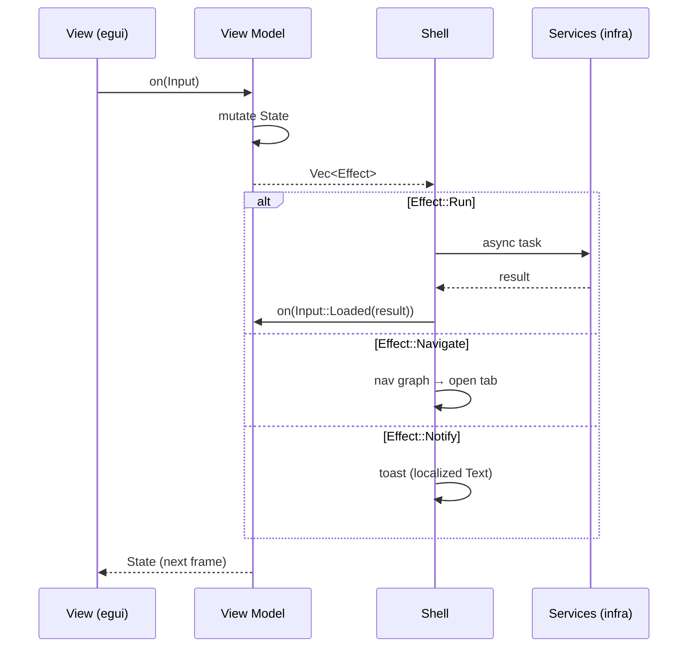

## CRDT Sync System

Every syncable entity carries a vector clock. Local writes go to a pending queue; remote changes
are compared clock-to-clock, and concurrent edits go through a conflict resolver.

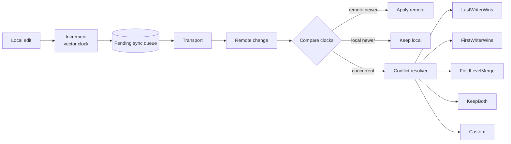

CRDT types in `arcana-sync`: vector clock, LWW register, multi-value register; field policies
(`LocalOnly` / `RemoteOnly` / …) drive field-level merge. Property tests (`crdt_properties`) check
the merge laws.

## Key Features

| Area | What is there |
|---|---|
| **Clean Architecture** | 12 workspace packages, dependency direction enforced by `cargo xtask layers` in CI |
| **MVVM UDF** | Input → State → Effect view models; I/O only through effects interpreted by the shell |
| **Plugins** | Built-in (FlowChart editor) + sandboxed WASM components; manifest permissions, semver dependencies, activation events, menu/view/command contributions |
| **Offline sync** | Vector clocks, LWW / MV registers, 5 conflict-resolution strategies, pending queue |
| **Security** | PBKDF2-SHA256 password hashing (100,000 iterations, versioned hash format), authorization service, permission manager |
| **Data** | SQLite via sqlx with migrations; repositories + unit of work |
| **i18n** | en-US, zh-TW, ja-JP with system-locale detection; per-OS CJK font fallback |
| **Themes** | Light / dark |
| **Platforms** | Windows (.msi), macOS (.dmg), Linux (.deb, .AppImage) |

## Project Structure

```
arcana-desktop-rust/
├── crates/
│   ├── arcana-core/          # errors, result types, shared abstractions
│   ├── arcana-domain/        # entities (customer, product, order), validators
│   ├── arcana-data/          # SQLite (sqlx), repositories, unit of work
│   ├── arcana-sync/          # CRDT: vector clock, LWW, MV register, conflict resolver
│   ├── arcana-plugin-api/    # plugin contracts, manifest, contributions
│   ├── arcana-plugin-host/   # lifecycle, dependency resolver, registries, permissions
│   ├── arcana-plugin-wasm/   # Wasmtime component-model sandbox
│   ├── arcana-infra/         # auth, security, locale, services
│   ├── arcana-ui/            # egui shell, pages, view models, theme, l10n
│   └── arcana-app/           # composition root (+ screenshots bin)
├── plugins/flowchart/        # built-in FlowChart editor plugin
├── plugins-wasm/example/     # sample third-party WASM plugin
├── xtask/                    # `cargo xtask layers`
├── packaging/ scripts/       # installers, CI scripts
└── docs/                     # PORTING_PLAN.md, screenshots
```

Plan and milestones: [docs/PORTING_PLAN.md](docs/PORTING_PLAN.md).

## Quick Start

```bash
cargo run                    # desktop app
bash scripts/ci-check.sh     # the CI gate: fmt, layers, clippy pedantic, tests + coverage
cargo xtask layers           # dependency-direction check only
```

### Prerequisites (per OS)

Rust stable (`rustup`, edition 2024) on every OS. Release binary: `cargo build --release -p arcana-app`
→ `target/release/arcana-app[.exe]`. Data (SQLite, logs, plugins) goes to the OS data directory.

| OS | Prerequisites | Notes |
|---|---|---|
| Windows 10/11 | MSVC build tools (Visual Studio "Desktop development with C++") | CJK font: Microsoft JhengHei → Yu Gothic UI → Microsoft YaHei (built in) |
| macOS 11+ | Xcode Command Line Tools (`xcode-select --install`) | CJK font: PingFang TC → Hiragino Sans (built in) |
| Linux (X11 or Wayland) | see below | CJK font: Noto Sans CJK → WenQuanYi; install one or zh-TW/ja-JP shows boxes (a status-bar warning says so) |

Linux system packages (Debian/Ubuntu names; build and run):

```bash
sudo apt-get install build-essential pkg-config libgl1-mesa-dev libegl1-mesa-dev \
  libxkbcommon-dev libwayland-dev libxcursor1 libxrandr2 libxi6 libx11-xcb1 fonts-noto-cjk
```

File dialogs use the XDG desktop portal on Linux (`xdg-desktop-portal` + a backend such as
`-gtk`/`-kde`); without a portal the app falls back to typing a path.

## Install (release artifacts)

Each GitHub Release (cut by release-please) carries installers built by
`.github/workflows/package.yml` / `scripts/package.sh`:

- **Windows** `arcana-desktop-<v>-x86_64.msi` (cargo-wix / WiX v3) — double-click; unsigned, so
  SmartScreen asks once ("More info → Run anyway").
- **macOS** `Arcana-<v>-arm64.dmg` — drag Arcana.app to Applications. Ad-hoc signed only: first
  launch via right-click → Open (or `xattr -dr com.apple.quarantine /Applications/Arcana.app`).
- **Linux** `arcana-desktop_<v>_amd64.deb` (`sudo apt install ./arcana-desktop_*.deb`) or
  `Arcana-<v>-x86_64.AppImage` (`chmod +x` and run; needs `libfuse2`).

Local: `bash scripts/package.sh <linux|macos|windows> [version]` → `dist/`.

**Follow-ups (not done):** macOS Developer ID signing + notarization (`codesign --options runtime`
with a Developer ID cert, `xcrun notarytool submit --wait`, `xcrun stapler staple` on the .dmg —
needs an Apple Developer account secret in CI); Windows Authenticode signing of the .msi.

## Testing

**1,254 tests, all passing** (1 ignored) — `cargo test --workspace` on macOS, 2026-10-16.
**Line coverage 88.2%** (regions 86.5%, functions 89.2%) — `cargo llvm-cov --workspace --summary-only`.

### Test Summary by Crate

| Crate | Tests | Line coverage |
|---|---:|---:|
| `arcana-plugin-host` | 391 | 87.0% |
| `arcana-infra` | 306 | 95.9% |
| `arcana-sync` | 138 | 97.6% |
| `arcana-domain` | 105 | 100.0% |
| `arcana-ui` | 96 | 84.1% |
| `arcana-plugin-api` | 72 | 81.6% |
| `arcana-plugin-flowchart` | 66 | 89.6% |
| `arcana-data` | 40 | 99.0% |
| `arcana-plugin-wasm` | 21 | 88.2% |
| `arcana-core` | 16 | 100.0% |
| `arcana-app` | 3 | 52.8% |
| `xtask` | 0 | 0.0% |
| **Total** | **1,254** | **88.2%** |

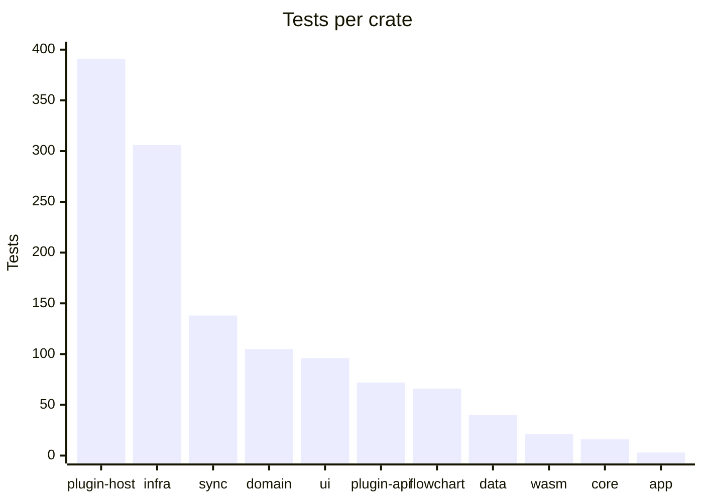

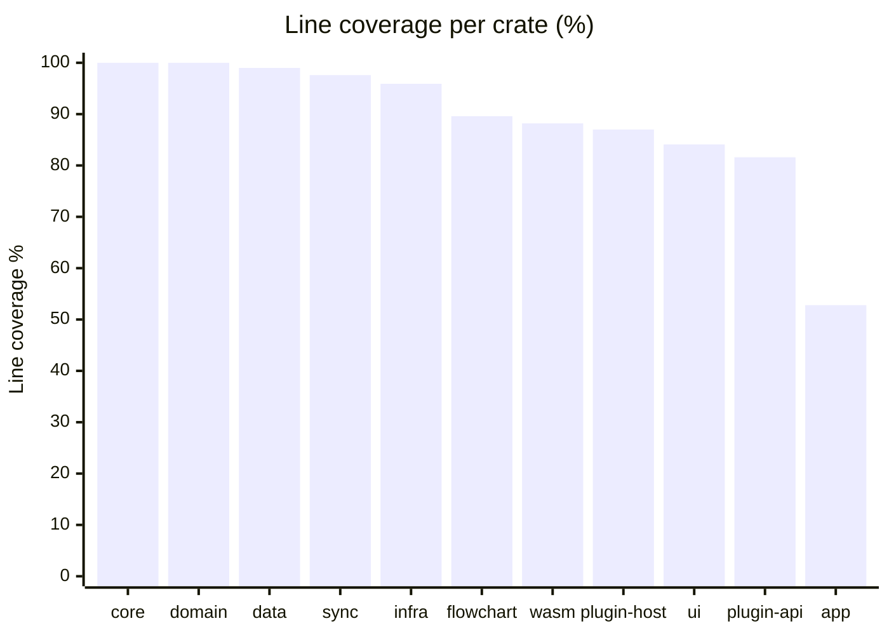

### Running Tests

```bash
bash scripts/build-wasm-example.sh            # the sandbox tests load the example component
cargo test --workspace                        # all tests
cargo llvm-cov --workspace --summary-only     # coverage summary
cargo llvm-cov --workspace --lcov --output-path lcov.info   # what CI sends to SonarQube
```

## Code Quality

SonarQube project `desktop-rust-app` (main, 2026-10-16):

| Metric | Value |
|---|---|
| Quality Gate | **OK** |
| Bugs / Vulnerabilities | 0 / 0 |
| Reliability / Security / Maintainability rating | A / A / A |
| Code smells | 30 |
| Duplicated lines | 0.9% |
| Lines of code (ncloc) | 44,351 |

Clippy runs with `all + pedantic` and `-D warnings` (`scripts/ci-check.sh`); `cargo fmt --check`
and `cargo xtask layers` run in the same gate.

## CI

Jenkins (`Jenkinsfile`, job `desktop-rust-app-pipeline-mb`) runs three platforms in parallel; any
red fails the build. Last main build (#13): **Linux ✅ Windows ✅ macOS ✅**.

| Platform | Agent | Steps |
|---|---|---|
| Linux | bluesea, Docker | `Dockerfile.ci --target ci` = `scripts/ci-check.sh`, then `--target gui` = `scripts/gui-smoke.sh` (real app under Xvfb and headless Weston; screenshot must not be blank), SonarQube, Architecture Qube (`rust` profile, threshold 90, blocking) |
| Windows | Windows agent | `scripts/ci-windows.ps1`: `cargo test --workspace` + release build |
| macOS | Mac mini | `scripts/ci-native.sh`: `cargo test --workspace` + release build + .dmg |

Both native agents install rustup for the build user first if cargo is missing. GitHub Actions
(`package.yml`) builds the installers on each release; `release-please.yml` cuts releases.

## Architecture Evaluation

### Overall Rating: ⭐⭐⭐⭐ 8.5/10

Scored with the same category-table rubric as the other Arcana READMEs; every score cites the
measurement behind it, and the overall is the plain average.

| Category | Score | Evidence |
|---|---|---|
| **Clean Architecture** | 8.5/10 | Layer allow-list enforced in CI (`cargo xtask layers`); arch-qube `rust` 100, but the stricter `rust-desktop` profile finds 10 direction violations (97.8) |
| **Plugin System** | 9.0/10 | Built-in + Wasmtime component sandbox, permission-gated imports, semver dependency resolution; plugin-host 391 tests |
| **MVVM UDF** | 8.5/10 | Input/State/Effect, I/O only via effects; some view-model ↔ view type coupling (rust-desktop findings) |
| **Sync Engine** | 9.0/10 | Vector clocks, LWW/MV registers, 5 strategies, property tests; 138 tests, 97.6% line coverage |
| **Security** | 8.5/10 | PBKDF2-SHA256 100k iterations with versioned hashes, authorization + permission manager; no at-rest DB encryption |
| **Testing** | 9.0/10 | 1,254 tests, 88.2% line coverage; `arcana-app` 52.8%, GUI covered by kittest flows + Linux GUI smoke |
| **Code Quality** | 9.5/10 | Sonar A/A/A, 0 bugs, 0 vulnerabilities, 0.9% duplication; clippy pedantic `-D warnings` |
| **Cross-Platform** | 9.0/10 | Windows / macOS / Linux all green in one pipeline; .msi / .dmg / .deb / .AppImage |
| **Distribution** | 6.5/10 | Installers are unsigned (no Authenticode, no Developer ID / notarization) |
| **Documentation** | 7.5/10 | Porting plan, this README, module docs; no separate plugin-development guide yet |

### Strengths

- **Architecture as code**: the dependency allow-list fails CI, and an unlisted crate fails too, so the rule cannot drift behind the code.
- **Real sandbox for third-party plugins**: WASM components only reach the host through imports their manifest was granted.
- **Pure view models**: UI logic is testable without a window; screenshots and UI flows run headless.
- **One pipeline, three OSes**: no platform is "supported" without being built and tested on every main build.

### Considerations

| Aspect | Trade-off | Mitigation |
|---|---|---|
| **arch-qube coverage of UI** | CI profile does not classify `arcana-ui` | Move to `rust-desktop` once arcana-arch-qube#12 lands and the 10 findings are fixed |
| **Unsigned installers** | SmartScreen / Gatekeeper prompts on first run | Signing + notarization listed as follow-ups |
| **Immediate-mode UI** | egui redraws every frame; no native widgets | Effects keep I/O off the UI thread |

## License

MIT License - see [LICENSE](LICENSE) file for details.

---

<div align="center">

**Built with Rust (edition 2024) | egui / eframe 0.36 | Wasmtime 49 | sqlx + SQLite | Tokio**

</div>
